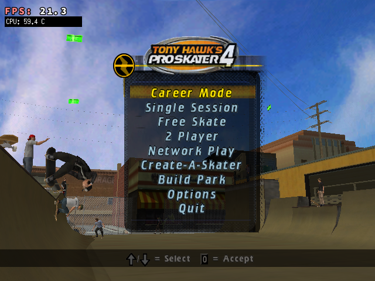

# Tony Hawk's Pro Skater 4 on Miyoo Flip V2

An experimental, reproducible setup for the **PC version of THPS4** on the
Miyoo Flip V2 running Spruce. Supply your own legally obtained PC game files.
No game executable, game assets, activation material, personal Wine prefix,
or save files are distributed here.

This is a Wine/Box86 compatibility setup using Vulkan, not a native engine
port and not PS2 emulation. It is not an official PortMaster release.

## What actually works

Tested on one Flip V2, Spruce 4.5.6, RK3566/Cortex-A55, Mali-G52, 1 GB RAM,
640×480 display, Linux 5.10.160. Menus, textures, sound, College gameplay,
controller mapping and career saving worked in the tested installation.
The complete campaign and every PC release have not been validated.

Player reports were generally **20–30 FPS**, with busy-area dips around
**15–20 FPS** in the later copy-optimized build. An earlier Vulkan run dipped
into 10–15 FPS. These are observations, not a controlled claim of a specific
percentage speedup. The CPU clock and temperature changed between tests.
This is not a locked-30 or 60-FPS claim.

The selected route is:

    THPS4 PC → Wine 8.21 x86 → Box86 ARMhf → panDXVK D3D8/9
             → BCn compute decoding → private Mali G29 ARMhf Vulkan
             → cached X11 SHM presentation → Weston/Crusty → display

The game entry is simply **THPS4**. The FPS counter stays in the top-left
corner; a small CPU-temperature counter appears underneath it.

## Setup

See [the installation guide](docs/installation.md). Build the runtime from
pinned upstream components on x86_64 Linux, package your own installed Game directory, then
copy the generated files to the SD card. Original game files are never
uploaded by the tools. The installer preserves existing saves and prefixes.

- [Build and dependency details](docs/build.md)
- [Controls and troubleshooting](docs/troubleshooting.md)
- [Findings and failed approaches](docs/findings.md)
- [Performance evidence and its limits](docs/performance.md)
- [Source provenance and licenses](THIRD_PARTY_NOTICES.md)
- [Reddit post draft](docs/reddit-post.md)

## Improvements that made a difference

1. Switching the old WineD3D/GL path to Vulkan made the game playable.
2. Profiling found a full 640×480×4-byte GPU-to-X11 shared-memory copy in
   native libc. Cached host-visible memory plus explicit invalidation made
   that copy substantially cheaper; the player also reported faster skating.
3. A narrowly matched Wine SSE2 memmove routine can use Box86's existing
   native-call bridge to ARM libc. Correctness probes passed, and the
   translated copy hotspot disappeared. A separate FPS gain from this second
   change has not been established.

The original working checkpoint was kept throughout the experiments. Public
research includes failures as well as successes; material tests alone did
not guarantee that the full game would present frames correctly.

## Reuse and contributions

The scripts are specific to this Spruce/Flip configuration. Other handhelds
need their own display backend, driver and memory validation. Please report
hardware, firmware, game-build fingerprint, scene, clock/temperature, graphics
correctness and save results when comparing changes. Do not attach game files,
keys, personal prefixes or unreviewed memory captures to issues.

Video: the maintainer's handheld recording will be added when available.
